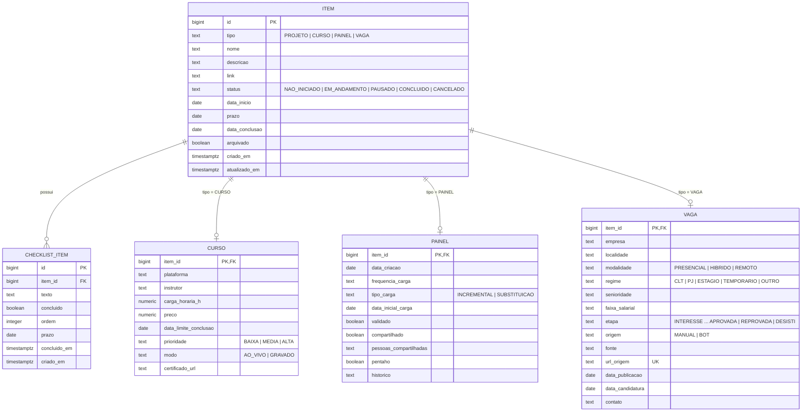

# DER — Organizador

Schema: `organizador` (PostgreSQL / Supabase)

`item` é a base de todos os cards. `curso`, `painel` e `vaga` são extensões 1:1
(a PK delas é o próprio `item_id`). Projeto não tem tabela própria: usa `item` + `checklist_item`.

## Views

| View | Para quê |
|---|---|
| `vw_prazos_proximos` | Itens com prazo nos próximos 30 dias ou atrasados (cursos: o que vencer primeiro entre meta e limite) |
| `vw_progresso_checklist` | Total / concluídos / % por item |
| `vw_paineis_alerta_carga` | Em janeiro, lista painéis ativos com o primeiro ano de carga |
