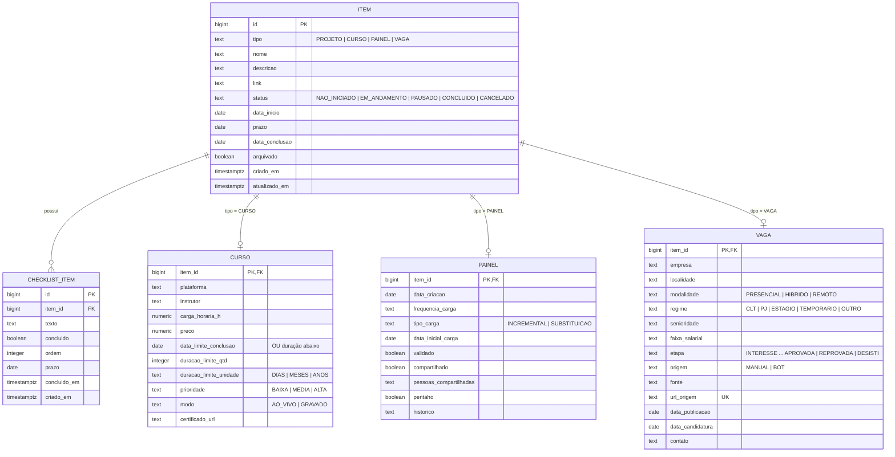

# DER — KeepUp

Schema: `keepup` (PostgreSQL / Supabase)

`item` é a base de todos os cards. `curso`, `painel` e `vaga` são extensões 1:1
(a PK delas é o próprio `item_id`). Projeto não tem tabela própria: usa `item` + `checklist_item`.

> Limitação aceita: o banco não garante que `item.tipo` combine com a tabela de extensão
> (ex.: um `curso` apontando para um item `VAGA`). Quem garante é o service, que cria o item com o tipo certo.
>
> Editar só `curso`, `painel` ou `vaga` também atualiza `item.atualizado_em` (trigger `fn_tocar_item`).

## Views

| View | Para quê |
|---|---|
| `vw_prazos_proximos` | Cards e etapas abertas do checklist com prazo nos próximos 30 dias ou atrasados (cursos: o que vencer primeiro entre meta e limite; limite por duração conta de `item.data_inicio`). Etapas aparecem como `card: etapa` |
| `vw_progresso_checklist` | Total / concluídos / % por item |
| `vw_paineis_alerta_carga` | Em janeiro, lista painéis não cancelados (inclui `CONCLUIDO`, que ainda tem cargas) com o primeiro ano de carga |
